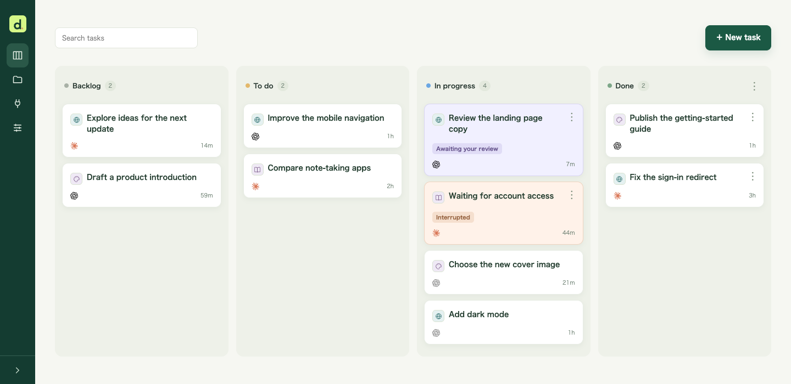
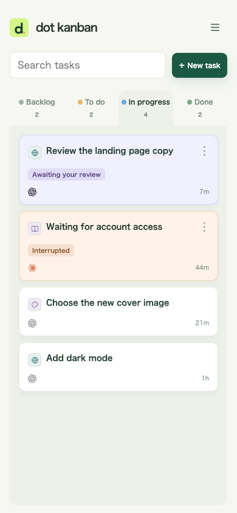
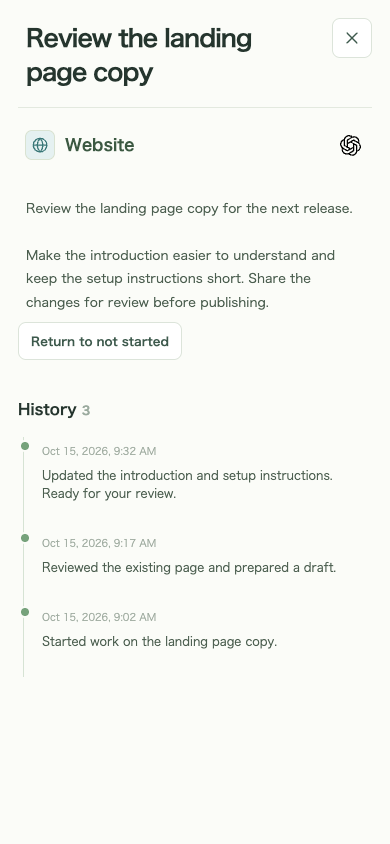

# dot kanban

**English** · [日本語](docs/README.ja.md) · [한국어](docs/README.ko.md) · [繁體中文](docs/README.zh-TW.md) · [简体中文](docs/README.zh-CN.md)

A private kanban board for requesting work from dot and tracking tasks, progress, and results. Works on phones and desktops.



## What you can do

- **Keep requests in one place:** save ideas in Backlog and move tasks to To do when ready for an agent.
- **Work with AI:** connect dot or another compatible agent through MCP and keep chat requests, progress, and results on the same task.
- **See what needs you:** distinguish work awaiting review or stopped from running tasks, and follow the execution history in task details.
- **Organize projects:** use project icons, reorder cards to set execution priority, and attach images to descriptions.
- **Use it on your phone:** swipe between panels, search tasks, and install the board as a PWA.

<p>
  
  
</p>

## Before setup

Both setup methods deploy your own private kanban to **your Cloudflare account**. If you do not have one, [create a Cloudflare account](https://dash.cloudflare.com/sign-up) first. For the Deploy button, also prepare a GitHub or GitLab account.

**The standard configuration is expected to fit Cloudflare’s free tier for typical personal use.** Request, database, and storage limits apply; heavy use or many image attachments may require a paid plan. AI service subscriptions and usage are separate. Current pricing and limits: [Workers](https://developers.cloudflare.com/workers/platform/pricing/) · [D1](https://developers.cloudflare.com/d1/platform/pricing/) · [KV](https://developers.cloudflare.com/kv/platform/pricing/) · [Access](https://www.cloudflare.com/plans/zero-trust-services/).

<details>
<summary>Free-tier estimates and limits</summary>

- With one board visible continuously, the three-second update check makes about **28,800 requests per day**, each reading one revision row. This is an estimate for update checks only; loading tasks, using MCP, and other requests add to it. Hidden tabs pause checks; multiple visible windows add traffic.
- [Workers Free](https://developers.cloudflare.com/workers/platform/pricing/) allows **100,000 requests per day per account** and **10 ms of CPU per request**. Other Workers share the allowance, and expensive processing can hit the CPU limit even at low traffic.
- [D1 Free](https://developers.cloudflare.com/d1/platform/limits/) limits each database to **500 MB**, including task history and attached images. It also has [daily row-read/write limits](https://developers.cloudflare.com/d1/platform/pricing/). Large image collections may require a paid plan.
- OAuth uses [KV](https://developers.cloudflare.com/kv/platform/pricing/), whose free limits include **1,000 key writes and 1,000 list operations per day**. Very frequent authentication or connection-list requests may exhaust these limits.

These estimates are based on the implementation and published limits, not measured operation on a Free-plan deployment. Check your Cloudflare usage dashboard. On Free, exceeding a limit can cause errors rather than automatically upgrading the plan. AI service fees are separate; the optional experimental Events/Container configuration requires a paid plan.

</details>

## Set up your board

Choose how to set it up: ask your dot to deploy and configure it, or use the button yourself.

### Ask your dot

```text
https://github.com/nocico-nocio/dot-kanban
Read INSTALL.md in this repository first, then follow it to set up my private board, connect dot, and configure scheduled checks. Ask me for any information or decisions you need.
For new work I request in chat, register it with create_task before starting, then record progress and results on that task; do not duplicate existing tasks.
```

See [INSTALL.md](INSTALL.md) for the full setup guide. During setup, dot will ask where work should run and how often to check the board.

### Deploy to Cloudflare yourself

Use the button to deploy to the account prepared above. No manual fork is needed beforehand: [Cloudflare creates a copy](https://developers.cloudflare.com/workers/platform/deploy-buttons/) in your GitHub/GitLab account and connects it to Workers Builds.

[](https://deploy.workers.cloudflare.com/?url=https://github.com/nocico-nocio/dot-kanban)

After deployment, follow [INSTALL.md](INSTALL.md) to configure owner-only sign-in and connect your agent through MCP. The button deploys the board; authentication and recurring checks still need setup.

## Updating your board

You can ask dot to update your existing board. With the button setup, incorporate changes from this source repository into your own copy; pushing to its connected production branch triggers a [new deployment](https://developers.cloudflare.com/workers/ci-cd/builds/git-integration/github-integration/). Upstream changes are not automatically synchronized. Back up the database and keep your existing Worker, database, and authentication settings. See [update instructions](INSTALL.md#updates-backups-and-rollback).

## Version history

### 1.0 — 2026-10-15

First release: private kanban, MCP task registration and progress tracking, projects, image attachments, and mobile/PWA support.

## Using other agents

The clients below provide MCP integration; available authentication and scheduling features vary by product and account. Grok integration with this board remains unverified. Copy the prompt for your agent below. Verify connection, task read/write tools, and recurring execution in the environment you use before relying on it.

| Agent                                                                                                                                          | Execution and recurring checks                                                               |
| ---------------------------------------------------------------------------------------------------------------------------------------------- | -------------------------------------------------------------------------------------------- |
|  [Claude / Claude Code](https://code.claude.com/docs/en/scheduled-tasks) | Local: `/loop` or local scheduled tasks. Cloud: `/schedule` routines.                        |
|  [Grok / Grok Build](https://docs.x.ai/grok/connectors)                    | Custom MCP / Grok Build; check scheduling support in the feature you use.                    |
|  [Codex](https://developers.openai.com/codex/mcp)                         | CLI/app MCP connections; configure recurring execution separately in the chosen environment. |
|  [Gemini CLI](https://geminicli.com/docs/tools/mcp-server/)              | Local MCP connections; configure an OS scheduler or another recurring runner separately.     |
|  [Cursor](https://cursor.com/docs/mcp)                                   | Desktop / Cloud Agent MCP connections; configure recurring execution in each environment.    |

**When cloud and local work use separate execution features, configure MCP and recurring checks for each.** Connecting alone does not start polling. With multiple connections, select a default on the MCP connections page and an assigned agent per task.

<details>
<summary>Claude / Claude Code — setup prompt</summary>

```text
https://github.com/nocico-nocio/dot-kanban
Read INSTALL.md in this repository first, then set up my board, MCP connection, and recurring checks for Claude / Claude Code. Ask me where work should run and how often to check. Clearly identify features this environment does not support.
For new work I request in chat, register it with create_task before starting, then record progress and results on that task; do not duplicate existing tasks.
```

</details>

<details>
<summary>Grok / Grok Build — setup prompt</summary>

```text
https://github.com/nocico-nocio/dot-kanban
Read INSTALL.md in this repository first, then set up my board, MCP connection, and recurring checks for Grok / Grok Build. Ask me where work should run and how often to check. Clearly identify features this environment does not support.
For new work I request in chat, register it with create_task before starting, then record progress and results on that task; do not duplicate existing tasks.
```

</details>

<details>
<summary>Codex — setup prompt</summary>

```text
https://github.com/nocico-nocio/dot-kanban
Read INSTALL.md in this repository first, then set up my board, MCP connection, and recurring checks for Codex. Ask me where work should run and how often to check. Clearly identify features this environment does not support.
For new work I request in chat, register it with create_task before starting, then record progress and results on that task; do not duplicate existing tasks.
```

</details>

<details>
<summary>Gemini CLI — setup prompt</summary>

```text
https://github.com/nocico-nocio/dot-kanban
Read INSTALL.md in this repository first, then set up my board, MCP connection, and recurring checks for Gemini CLI. Ask me where work should run and how often to check. Clearly identify features this environment does not support.
For new work I request in chat, register it with create_task before starting, then record progress and results on that task; do not duplicate existing tasks.
```

</details>

<details>
<summary>Cursor — setup prompt</summary>

```text
https://github.com/nocico-nocio/dot-kanban
Read INSTALL.md in this repository first, then set up my board, MCP connection, and recurring checks for Cursor. Ask me where work should run and how often to check. Clearly identify features this environment does not support.
For new work I request in chat, register it with create_task before starting, then record progress and results on that task; do not duplicate existing tasks.
```

</details>

MIT license: [LICENSE](LICENSE).
