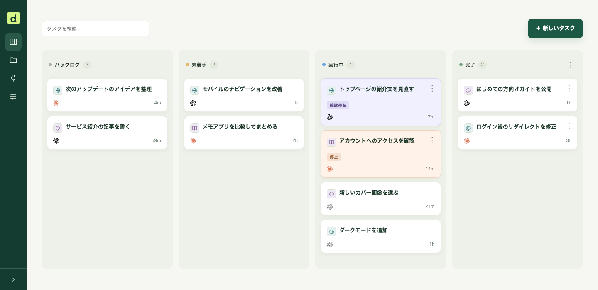
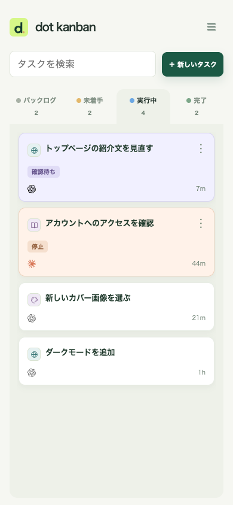
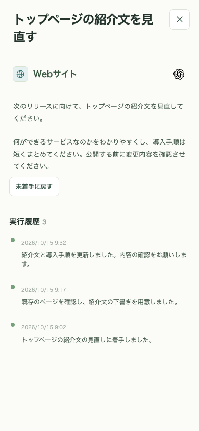

# dot kanban

[English](../README.md) · **日本語** · [한국어](README.ko.md) · [繁體中文](README.zh-TW.md) · [简体中文](README.zh-CN.md)

dot に仕事を依頼し、タスク・進捗・成果をまとめて管理する個人用の非公開カンバンです。スマホとデスクトップで使えます。



## できること

- **思いついた依頼を残す：** バックログに保存し、AIに進めてほしいタスクを未着手へ移動できます。
- **AIと一緒に進める：** dotなどの対応エージェントをMCPで接続し、会話での依頼も進捗・結果も同じタスクにまとめられます。
- **自分の確認が必要な作業を見つける：** 確認待ち・停止を実行中と区別し、詳細の実行履歴で経緯を追えます。
- **プロジェクトごとに整理する：** アイコンで見分け、カードの並び順で実行の優先順を決め、説明文に画像を添付できます。
- **スマホでも使う：** スワイプでパネルを切り替え、タスクを検索。PWAとしてホーム画面にも追加できます。

<p>
  
  
</p>

## 準備するもの

どちらの方法でも、**あなたのCloudflareアカウントに、自分専用の非公開kanbanをデプロイします。** アカウントを持っていなければ、先に[Cloudflareアカウントを作成](https://dash.cloudflare.com/sign-up)してください。デプロイボタンを使う場合は、GitHubまたはGitLabのアカウントも用意します。

**標準構成で通常の個人利用なら、Cloudflareの無料枠内での運用を見込めます。** リクエスト数・DB容量・保存量などに上限があり、大量の利用や画像添付では有料プランが必要になる場合があります。AIサービスの契約・利用料金は別途必要です。現在の料金・上限：[Workers](https://developers.cloudflare.com/workers/platform/pricing/) · [D1](https://developers.cloudflare.com/d1/platform/pricing/) · [KV](https://developers.cloudflare.com/kv/platform/pricing/) · [Access](https://www.cloudflare.com/plans/zero-trust-services/)。

<details>
<summary>無料枠の目安と注意点</summary>

- ボード1画面を24時間表示し続けると、3秒ごとの更新確認は**約28,800リクエスト／日**です。毎回読むのは更新番号の1行だけです。これは更新確認だけの試算で、タスクの再取得・MCPなどの通信は別に加わります。非表示タブでは確認を止めますが、複数ウィンドウを表示すれば通信量は増えます。
- [Workers無料枠](https://developers.cloudflare.com/workers/platform/pricing/)は**アカウント全体で10万リクエスト／日、1リクエストあたりCPU 10ms**です。他のWorkerとも枠を共有し、処理が重い場合は通信量が少なくてもCPU上限に達することがあります。
- [D1無料枠](https://developers.cloudflare.com/d1/platform/limits/)は**DB1個あたり500MB**で、タスク履歴や添付画像も含みます。[1日の読み取り・書き込み量にも上限](https://developers.cloudflare.com/d1/platform/pricing/)があるため、画像を大量に保存する場合などは有料プランが必要になることがあります。
- OAuthに使う[KV](https://developers.cloudflare.com/kv/platform/pricing/)にも、無料枠では**キーの書き込み・一覧取得がそれぞれ1,000回／日**などの制限があります。頻繁な認証や接続一覧の取得で上限に達することがあります。

上記は実装と公開上限に基づく目安で、無料プランでの実測結果ではありません。Cloudflareの利用状況画面で確認してください。無料枠を超えた場合は、自動で有料になるのではなくエラーで利用できなくなることがあります。AIサービスの料金は別で、任意の実験用Events／Container構成は有料プランが必要です。

</details>

## セットアップ

dotにデプロイと設定を頼むか、自分でボタンを押して進めるかを選べます。

### あなたのdotに頼む

```text
https://github.com/nocico-nocio/dot-kanban
このリポジトリの docs/INSTALL.ja.md を最初に読み、その手順に沿って自分用のカンバンの導入からdot接続・定期巡回の設定まで進めてください。必要な確認は私に聞いてください。
会話で私が新しく依頼した作業も、着手前にcreate_taskで登録し、同じタスクに進捗・結果を記録してください。既存タスクは重複登録しないでください。
```

詳しい手順は [INSTALL.ja.md](INSTALL.ja.md) にまとめています。実行場所や巡回間隔も、導入時にdotが確認します。

### 自分でCloudflareにデプロイする

上で用意したアカウントに、次のボタンからデプロイします。事前に手動でForkする必要はありません。[CloudflareがGitHub／GitLabの自分のアカウントにリポジトリのコピーを作成](https://developers.cloudflare.com/workers/platform/deploy-buttons/)し、Workers Buildsと連携します。

[](https://deploy.workers.cloudflare.com/?url=https://github.com/nocico-nocio/dot-kanban)

デプロイ後は [INSTALL.ja.md](INSTALL.ja.md) に沿って、本人限定のログインとエージェントのMCP接続を設定してください。ボタンでボードをデプロイした後も、認証と定期巡回の設定が必要です。

## アップデート

更新もdotに「既存のkanbanを最新版に更新して」と頼めます。ボタンで導入した場合は、元リポジトリの変更を自分のコピーへ取り込み、連携先の本番ブランチにpushすると[再デプロイされます](https://developers.cloudflare.com/workers/ci-cd/builds/git-integration/github-integration/)。元リポジトリの変更は自動では取り込まれません。DBをバックアップし、既存のWorker・DB・認証設定を保って更新してください。[詳しい更新手順](INSTALL.ja.md#updates)を参照してください。

## バージョン履歴

### 1.0 — 2026-10-15

初回リリース。個人用カンバン、MCP経由のタスク登録・進捗記録、プロジェクト管理、画像添付、モバイル・PWA対応。

## 他のエージェントを使う場合

以下はMCP連携を提供するクライアントです。認証・定期実行の対応範囲は製品やアカウントによって異なり、このボードでのGrok接続は未検証です。各指示文をコピーして渡してください。利用する環境で接続・タスクの読み書き・定期実行を検証してから運用します。

| エージェント                                                                                                                                      | 実行・定期確認                                                         |
| ------------------------------------------------------------------------------------------------------------------------------------------------- | ---------------------------------------------------------------------- |
|  [Claude / Claude Code](https://code.claude.com/docs/en/scheduled-tasks) | 端末は `/loop` やローカル定期実行、クラウドは `/schedule` のルーチン。 |
|  [Grok / Grok Build](https://docs.x.ai/grok/connectors)                    | カスタムMCP／Grok Build。定期実行の可否は利用機能で確認。              |
|  [Codex](https://developers.openai.com/codex/mcp)                         | CLI・アプリのMCP接続。定期実行は使用環境の機能で別途設定。             |
|  [Gemini CLI](https://geminicli.com/docs/tools/mcp-server/)              | 端末側のMCP接続。定期実行はOSのスケジューラーなどで別途設定。          |
|  [Cursor](https://cursor.com/docs/mcp)                                   | デスクトップ／Cloud AgentのMCP接続。各環境で定期実行を別途設定。       |

**クラウドと端末で別の実行機能を使う場合は、それぞれにMCP接続と定期実行を設定します。** 接続だけでは巡回は始まりません。複数接続時は、MCP接続ページでデフォルト、タスクで担当エージェントを選べます。

<details>
<summary>Claude / Claude Codeに渡す指示文</summary>

```text
https://github.com/nocico-nocio/dot-kanban
このリポジトリの docs/INSTALL.ja.md を最初に読み、Claude / Claude Code から使えるように導入・MCP接続・定期巡回の設定を進めてください。実行場所と巡回間隔は私に確認し、この環境で未対応の機能は明記してください。
会話で私が新しく依頼した作業も、着手前にcreate_taskで登録し、同じタスクに進捗・結果を記録してください。既存タスクは重複登録しないでください。
```

</details>

<details>
<summary>Grok / Grok Buildに渡す指示文</summary>

```text
https://github.com/nocico-nocio/dot-kanban
このリポジトリの docs/INSTALL.ja.md を最初に読み、Grok / Grok Build から使えるように導入・MCP接続・定期巡回の設定を進めてください。実行場所と巡回間隔は私に確認し、この環境で未対応の機能は明記してください。
会話で私が新しく依頼した作業も、着手前にcreate_taskで登録し、同じタスクに進捗・結果を記録してください。既存タスクは重複登録しないでください。
```

</details>

<details>
<summary>Codexに渡す指示文</summary>

```text
https://github.com/nocico-nocio/dot-kanban
このリポジトリの docs/INSTALL.ja.md を最初に読み、Codex から使えるように導入・MCP接続・定期巡回の設定を進めてください。実行場所と巡回間隔は私に確認し、この環境で未対応の機能は明記してください。
会話で私が新しく依頼した作業も、着手前にcreate_taskで登録し、同じタスクに進捗・結果を記録してください。既存タスクは重複登録しないでください。
```

</details>

<details>
<summary>Gemini CLIに渡す指示文</summary>

```text
https://github.com/nocico-nocio/dot-kanban
このリポジトリの docs/INSTALL.ja.md を最初に読み、Gemini CLI から使えるように導入・MCP接続・定期巡回の設定を進めてください。実行場所と巡回間隔は私に確認し、この環境で未対応の機能は明記してください。
会話で私が新しく依頼した作業も、着手前にcreate_taskで登録し、同じタスクに進捗・結果を記録してください。既存タスクは重複登録しないでください。
```

</details>

<details>
<summary>Cursorに渡す指示文</summary>

```text
https://github.com/nocico-nocio/dot-kanban
このリポジトリの docs/INSTALL.ja.md を最初に読み、Cursor から使えるように導入・MCP接続・定期巡回の設定を進めてください。実行場所と巡回間隔は私に確認し、この環境で未対応の機能は明記してください。
会話で私が新しく依頼した作業も、着手前にcreate_taskで登録し、同じタスクに進捗・結果を記録してください。既存タスクは重複登録しないでください。
```

</details>

MIT ライセンス：[LICENSE](../LICENSE)。
