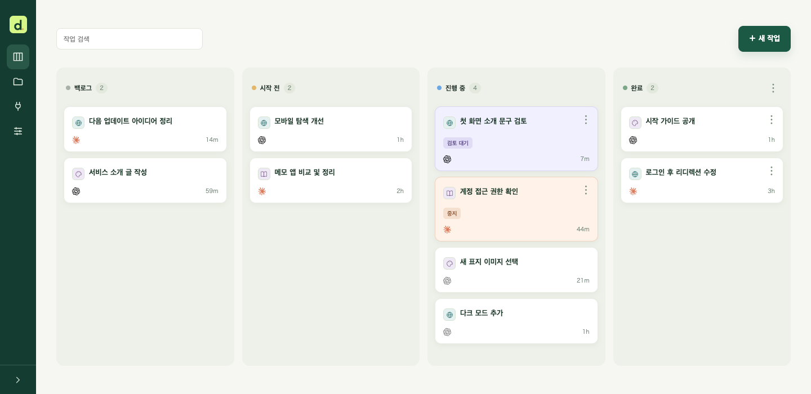
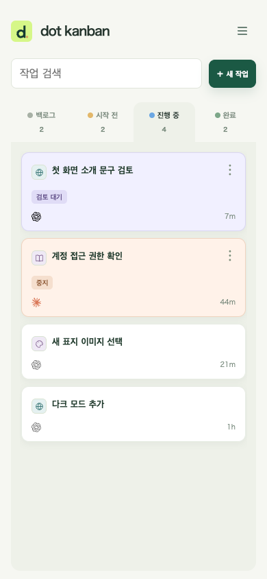
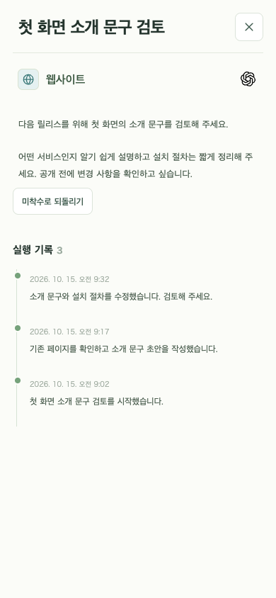

# dot kanban

[English](../README.md) · [日本語](README.ja.md) · **한국어** · [繁體中文](README.zh-TW.md) · [简体中文](README.zh-CN.md)

dot에 작업을 요청하고 작업·진행 상황·결과를 한곳에서 관리하는 개인용 비공개 칸반입니다. 휴대전화와 데스크톱에서 사용할 수 있습니다.



## 할 수 있는 일

- **요청을 한곳에 모으기:** 아이디어를 백로그에 저장하고 에이전트가 처리할 작업을 시작 전으로 옮깁니다.
- **AI와 함께 진행하기:** dot 등 호환 에이전트를 MCP로 연결하고, 대화에서 요청한 작업과 진행 상황·결과를 같은 작업에 기록합니다.
- **확인이 필요한 작업 찾기:** 검토 대기·중지를 실행 중과 구분하고 상세 화면의 실행 이력으로 경위를 확인합니다.
- **프로젝트별 정리:** 아이콘으로 구분하고 카드 순서로 실행 우선순위를 정하며 설명에 이미지를 첨부합니다.
- **휴대전화에서 사용:** 스와이프로 패널을 전환하고 작업을 검색하며 PWA로 홈 화면에 추가할 수 있습니다.

<p>
  
  
</p>

## 준비 사항

어느 방법이든 **본인의 Cloudflare 계정에 개인용 비공개 칸반을 배포합니다.** 계정이 없다면 먼저 [Cloudflare 계정을 만드세요](https://dash.cloudflare.com/sign-up). 배포 버튼에는 GitHub 또는 GitLab 계정도 필요합니다.

**표준 구성의 일반적인 개인 사용은 Cloudflare 무료 사용량 범위에 들어갈 것으로 예상됩니다.** 요청 수·DB 용량·저장량에는 한도가 있어 많은 사용이나 이미지 첨부에는 유료 플랜이 필요할 수 있습니다. AI 서비스 구독과 사용 요금은 별도입니다. 현재 요금과 한도: [Workers](https://developers.cloudflare.com/workers/platform/pricing/) · [D1](https://developers.cloudflare.com/d1/platform/pricing/) · [KV](https://developers.cloudflare.com/kv/platform/pricing/) · [Access](https://www.cloudflare.com/plans/zero-trust-services/).

<details>
<summary>무료 사용량 예상과 제한</summary>

- 보드 한 화면을 24시간 표시하면 3초마다 하는 갱신 확인은 **하루 약 28,800회 요청**이며 매번 버전 행 하나만 읽습니다. 작업 다시 읽기·MCP 등은 별도입니다. 숨긴 탭은 확인을 멈추지만 여러 창을 표시하면 요청이 늘어납니다.
- [Workers 무료 플랜](https://developers.cloudflare.com/workers/platform/pricing/)은 **계정 전체 하루 100,000회 요청, 요청당 CPU 10ms**입니다. 다른 Worker와 한도를 공유하며 적은 요청도 무거운 처리라면 CPU 한도에 걸릴 수 있습니다.
- [D1 무료 플랜](https://developers.cloudflare.com/d1/platform/limits/)은 **DB당 500MB**이며 작업 이력과 이미지도 포함합니다. [일일 읽기·쓰기 한도](https://developers.cloudflare.com/d1/platform/pricing/)도 있어 많은 이미지를 저장하면 유료 플랜이 필요할 수 있습니다.
- OAuth에 사용하는 [KV](https://developers.cloudflare.com/kv/platform/pricing/)도 **키 쓰기와 목록 조회가 각각 하루 1,000회**로 제한됩니다. 잦은 인증이나 연결 목록 조회로 한도에 도달할 수 있습니다.

구현과 공개 한도에 따른 예상이며 무료 플랜에서 실측한 결과는 아닙니다. Cloudflare 사용량 화면을 확인하세요. 무료 한도를 초과하면 자동 업그레이드 대신 오류가 발생할 수 있습니다. AI 요금은 별도이며 실험용 Events/Container 구성은 유료 플랜이 필요합니다.

</details>

## 설정하기

dot에게 배포와 설정을 요청하거나, 직접 버튼을 눌러 진행할 수 있습니다.

### dot에게 요청하기

```text
https://github.com/nocico-nocio/dot-kanban
먼저 이 저장소의 docs/INSTALL.ko.md를 읽고, 안내에 따라 개인용 보드 설치부터 dot 연결과 정기 확인 설정까지 진행해 주세요. 필요한 사항은 제게 물어보세요.
대화에서 새로 요청한 작업도 시작 전에 create_task로 등록하고 같은 작업에 진행 상황과 결과를 기록하세요. 기존 작업을 중복 등록하지 마세요.
```

자세한 절차는 [INSTALL.ko.md](INSTALL.ko.md)에 있습니다. 실행 위치와 확인 주기도 설치 과정에서 dot이 확인합니다.

### Cloudflare에 직접 배포하기

준비한 계정에 아래 버튼으로 배포합니다. 미리 수동으로 fork할 필요는 없습니다. [Cloudflare가 본인의 GitHub/GitLab 계정에 저장소 사본을 만들고](https://developers.cloudflare.com/workers/platform/deploy-buttons/) Workers Builds에 연결합니다.

[](https://deploy.workers.cloudflare.com/?url=https://github.com/nocico-nocio/dot-kanban)

배포 후 [INSTALL.ko.md](INSTALL.ko.md)에 따라 소유자 전용 로그인과 에이전트 MCP 연결을 설정하세요. 버튼으로 보드를 배포한 뒤에도 인증과 정기 확인 설정이 필요합니다.

## 업데이트

dot에게 기존 칸반을 최신 버전으로 업데이트해 달라고 요청할 수 있습니다. 버튼으로 설치했다면 원본 변경 사항을 본인 사본에 반영하고 연결된 운영 브랜치에 push하면 [다시 배포됩니다](https://developers.cloudflare.com/workers/ci-cd/builds/git-integration/github-integration/). 원본 변경은 자동 동기화되지 않습니다. DB를 백업하고 기존 Worker·DB·인증 설정을 유지하세요. [업데이트 절차](INSTALL.ko.md#updates)를 참고하세요.

## 버전 기록

### 1.0 — 2026-10-15

첫 릴리스. 개인용 칸반, MCP 작업 등록·진행 기록, 프로젝트 관리, 이미지 첨부, 모바일·PWA 지원.

## 다른 에이전트 사용

다음 클라이언트는 MCP 연동을 제공합니다. 인증·정기 실행 지원은 제품과 계정에 따라 다르며, 이 보드의 Grok 연결은 아직 검증하지 않았습니다. 해당 지시문을 복사해 전달하세요. 사용하는 환경에서 연결·작업 읽기/쓰기·정기 실행을 검증한 뒤 운영합니다.

| 에이전트                                                                                                                                          | 실행·정기 확인                                                      |
| ------------------------------------------------------------------------------------------------------------------------------------------------- | ------------------------------------------------------------------- |
|  [Claude / Claude Code](https://code.claude.com/docs/en/scheduled-tasks) | 기기는 `/loop` 또는 로컬 예약, 클라우드는 `/schedule` 루틴.         |
|  [Grok / Grok Build](https://docs.x.ai/grok/connectors)                    | 사용자 정의 MCP / Grok Build. 예약 지원은 사용하는 기능에서 확인.   |
|  [Codex](https://developers.openai.com/codex/mcp)                         | CLI·앱의 MCP 연결. 정기 실행은 선택한 환경에서 별도 설정.           |
|  [Gemini CLI](https://geminicli.com/docs/tools/mcp-server/)              | 기기 MCP 연결. OS 스케줄러 등으로 정기 실행을 별도 설정.            |
|  [Cursor](https://cursor.com/docs/mcp)                                   | 데스크톱 / Cloud Agent MCP 연결. 각 환경에서 정기 실행을 별도 설정. |

**클라우드와 기기가 별도 실행 기능이면 각각 MCP 연결과 정기 확인을 설정해야 합니다.** 연결만으로 시작되지 않습니다. 여러 연결이 있으면 MCP 연결 페이지에서 기본값을, 작업에서 담당 에이전트를 선택합니다.

<details>
<summary>Claude / Claude Code — 설정 지시문</summary>

```text
https://github.com/nocico-nocio/dot-kanban
먼저 이 저장소의 docs/INSTALL.ko.md를 읽고 Claude / Claude Code에서 사용할 보드 설치, MCP 연결, 정기 확인을 설정해 주세요. 실행 위치와 확인 주기는 제게 물어보고, 이 환경에서 지원하지 않는 기능은 명시해 주세요.
대화에서 새로 요청한 작업도 시작 전에 create_task로 등록하고 같은 작업에 진행 상황과 결과를 기록하세요. 기존 작업을 중복 등록하지 마세요.
```

</details>

<details>
<summary>Grok / Grok Build — 설정 지시문</summary>

```text
https://github.com/nocico-nocio/dot-kanban
먼저 이 저장소의 docs/INSTALL.ko.md를 읽고 Grok / Grok Build에서 사용할 보드 설치, MCP 연결, 정기 확인을 설정해 주세요. 실행 위치와 확인 주기는 제게 물어보고, 이 환경에서 지원하지 않는 기능은 명시해 주세요.
대화에서 새로 요청한 작업도 시작 전에 create_task로 등록하고 같은 작업에 진행 상황과 결과를 기록하세요. 기존 작업을 중복 등록하지 마세요.
```

</details>

<details>
<summary>Codex — 설정 지시문</summary>

```text
https://github.com/nocico-nocio/dot-kanban
먼저 이 저장소의 docs/INSTALL.ko.md를 읽고 Codex에서 사용할 보드 설치, MCP 연결, 정기 확인을 설정해 주세요. 실행 위치와 확인 주기는 제게 물어보고, 이 환경에서 지원하지 않는 기능은 명시해 주세요.
대화에서 새로 요청한 작업도 시작 전에 create_task로 등록하고 같은 작업에 진행 상황과 결과를 기록하세요. 기존 작업을 중복 등록하지 마세요.
```

</details>

<details>
<summary>Gemini CLI — 설정 지시문</summary>

```text
https://github.com/nocico-nocio/dot-kanban
먼저 이 저장소의 docs/INSTALL.ko.md를 읽고 Gemini CLI에서 사용할 보드 설치, MCP 연결, 정기 확인을 설정해 주세요. 실행 위치와 확인 주기는 제게 물어보고, 이 환경에서 지원하지 않는 기능은 명시해 주세요.
대화에서 새로 요청한 작업도 시작 전에 create_task로 등록하고 같은 작업에 진행 상황과 결과를 기록하세요. 기존 작업을 중복 등록하지 마세요.
```

</details>

<details>
<summary>Cursor — 설정 지시문</summary>

```text
https://github.com/nocico-nocio/dot-kanban
먼저 이 저장소의 docs/INSTALL.ko.md를 읽고 Cursor에서 사용할 보드 설치, MCP 연결, 정기 확인을 설정해 주세요. 실행 위치와 확인 주기는 제게 물어보고, 이 환경에서 지원하지 않는 기능은 명시해 주세요.
대화에서 새로 요청한 작업도 시작 전에 create_task로 등록하고 같은 작업에 진행 상황과 결과를 기록하세요. 기존 작업을 중복 등록하지 마세요.
```

</details>

MIT 라이선스: [LICENSE](../LICENSE).
