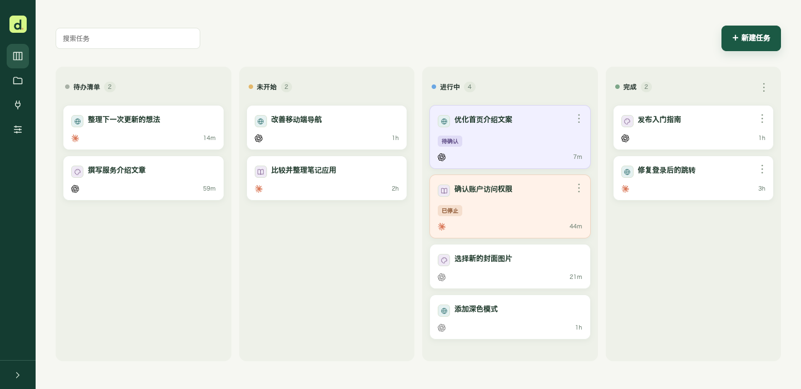
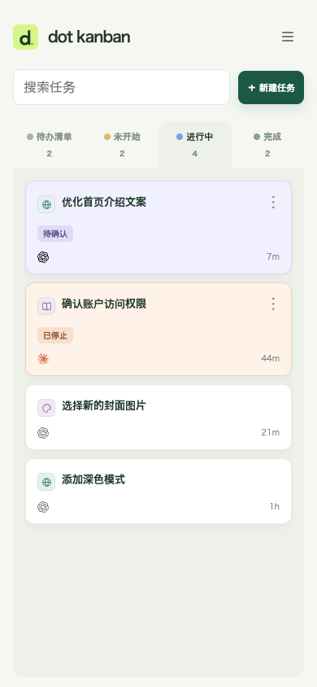
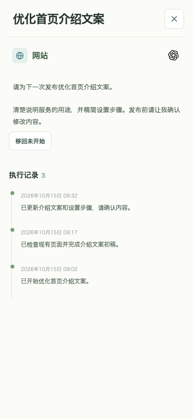

# dot kanban

[English](../README.md) · [日本語](README.ja.md) · [한국어](README.ko.md) · [繁體中文](README.zh-TW.md) · **简体中文**

向 dot 提交工作请求，集中管理任务、进度与成果的个人私有看板。适用于手机和桌面。



## 可以做什么

- **集中记录请求：** 将想法保存到待办列表，准备交给代理执行时移到未开始。
- **与 AI 一起推进：** 通过 MCP 连接 dot 等兼容代理，把对话中的请求、进度与结果记录在同一任务中。
- **找到需要你确认的工作：** 区分待确认、已停止与执行中任务，在详情的执行记录中了解经过。
- **按项目整理：** 用图标区分项目，以卡片顺序决定执行优先级，并在说明中添加图片。
- **在手机上使用：** 滑动切换面板、搜索任务，还可作为 PWA 添加到主屏幕。

<p>
  
  
</p>

## 准备事项

两种方法都会将**专属于你的私有看板部署到你自己的 Cloudflare 账户**。还没有账户时，请先[注册 Cloudflare](https://dash.cloudflare.com/sign-up)。使用部署按钮还需要 GitHub 或 GitLab 账户。

**标准配置的一般个人使用预计可在 Cloudflare 免费额度内运行。** 请求数、数据库容量和存储量等有上限，大量使用或图片附件可能需要付费方案。AI 服务订阅及使用费用另计。当前费用和限制：[Workers](https://developers.cloudflare.com/workers/platform/pricing/) · [D1](https://developers.cloudflare.com/d1/platform/pricing/) · [KV](https://developers.cloudflare.com/kv/platform/pricing/) · [Access](https://www.cloudflare.com/plans/zero-trust-services/)。

<details>
<summary>免费额度估算与注意事项</summary>

- 一个看板持续显示24小时，每3秒检查更新约为**28,800次请求／日**，每次只读取一行更新编号。任务重新读取、MCP 等请求另计。隐藏标签页会暂停检查，多个可见窗口则增加流量。
- [Workers 免费额度](https://developers.cloudflare.com/workers/platform/pricing/)为**每个账户10万次请求／日、每次请求 CPU 10ms**。与其他 Worker 共享额度，处理较重时即使请求少也可能达到 CPU 上限。
- [D1 免费方案](https://developers.cloudflare.com/d1/platform/limits/)为**每个数据库500MB**，包括任务记录与图片附件。另有[每日行读取／写入上限](https://developers.cloudflare.com/d1/platform/pricing/)，大量图片可能需要付费方案。
- OAuth 使用的 [KV](https://developers.cloudflare.com/kv/platform/pricing/)也有限制：**键写入与列表操作各1,000次／日**。频繁认证或读取连接列表可能耗尽额度。

以上按实现与公开上限估算，并非免费方案的实测结果。请查看 Cloudflare 用量页面；超过免费上限时可能返回错误，而非自动升级。AI 费用另计，可选的实验性 Events／Container 配置需要付费方案。

</details>

## 设置你的看板

可以请 dot 帮你部署并设置，也可以自己点击按钮完成。

### 请你的 dot 帮忙

```text
https://github.com/nocico-nocio/dot-kanban
请先阅读此仓库的 docs/INSTALL.zh-CN.md，按照步骤完成我的私有看板安装、dot 连接和定期检查设置。需要确认的事项请询问我。
对话中我新提出的工作也请在开始前用 create_task 登记，并在同一任务记录进度与结果。不要重复登记已有任务。
```

完整步骤请参阅 [INSTALL.zh-CN.md](INSTALL.zh-CN.md)。dot 会在安装时确认执行位置和检查间隔。

### 自行部署到 Cloudflare

通过下方按钮部署到准备好的账户，无须提前手动 Fork。[Cloudflare 会在你的 GitHub／GitLab 账户中创建仓库副本](https://developers.cloudflare.com/workers/platform/deploy-buttons/)，并连接 Workers Builds。

[](https://deploy.workers.cloudflare.com/?url=https://github.com/nocico-nocio/dot-kanban)

部署后按 [INSTALL.zh-CN.md](INSTALL.zh-CN.md) 设置仅限本人登录和代理的 MCP 连接。按钮部署看板后，仍须设置认证和定期检查。

## 更新看板

也可以请 dot 将现有看板更新到最新版。通过按钮安装后，将原仓库的更改合入自己的副本，push 到关联的生产分支即可[重新部署](https://developers.cloudflare.com/workers/ci-cd/builds/git-integration/github-integration/)。原仓库的更改不会自动同步。请备份数据库，并保留现有 Worker、数据库和认证设置。参阅[更新步骤](INSTALL.zh-CN.md#updates)。

## 版本历史

### 1.0 — 2026-10-15

首次发布。个人私有看板、MCP 任务登记与进度记录、项目管理、图片附件及移动端／PWA 支持。

## 使用其他代理

以下客户端提供 MCP 集成；认证和定期执行能力因产品和账户而异，本看板的 Grok 连接尚未验证。请复制对应的指令，先在使用环境中验证连接、任务读写和定期执行，再投入使用。

| 代理                                                                                                                                              | 执行与定期检查                                              |
| ------------------------------------------------------------------------------------------------------------------------------------------------- | ----------------------------------------------------------- |
|  [Claude / Claude Code](https://code.claude.com/docs/en/scheduled-tasks) | 本地使用 `/loop` 或本地调度，云端使用 `/schedule` routine。 |
|  [Grok / Grok Build](https://docs.x.ai/grok/connectors)                    | 自定义 MCP / Grok Build；请在使用的功能中确认调度支持。     |
|  [Codex](https://developers.openai.com/codex/mcp)                         | CLI／应用的 MCP 连接；在所选环境中另行设置定期执行。        |
|  [Gemini CLI](https://geminicli.com/docs/tools/mcp-server/)              | 本地 MCP 连接；使用系统调度器等另行设置定期执行。           |
|  [Cursor](https://cursor.com/docs/mcp)                                   | 桌面／Cloud Agent 的 MCP 连接；各环境分别设置定期执行。     |

**如云端与本地采用不同执行功能，须分别设置 MCP 连接和定期检查。** 单纯连接不会启动巡查。多个连接时，可在 MCP 连接页面选择默认，并为任务选择负责代理。

<details>
<summary>Claude / Claude Code — 设置指令</summary>

```text
https://github.com/nocico-nocio/dot-kanban
请先阅读此仓库的 docs/INSTALL.zh-CN.md，为 Claude / Claude Code 完成看板安装、MCP 连接和定期检查设置。请向我确认执行位置和检查间隔，并明确指出此环境不支持的功能。
对话中我新提出的工作也请在开始前用 create_task 登记，并在同一任务记录进度与结果。不要重复登记已有任务。
```

</details>

<details>
<summary>Grok / Grok Build — 设置指令</summary>

```text
https://github.com/nocico-nocio/dot-kanban
请先阅读此仓库的 docs/INSTALL.zh-CN.md，为 Grok / Grok Build 完成看板安装、MCP 连接和定期检查设置。请向我确认执行位置和检查间隔，并明确指出此环境不支持的功能。
对话中我新提出的工作也请在开始前用 create_task 登记，并在同一任务记录进度与结果。不要重复登记已有任务。
```

</details>

<details>
<summary>Codex — 设置指令</summary>

```text
https://github.com/nocico-nocio/dot-kanban
请先阅读此仓库的 docs/INSTALL.zh-CN.md，为 Codex 完成看板安装、MCP 连接和定期检查设置。请向我确认执行位置和检查间隔，并明确指出此环境不支持的功能。
对话中我新提出的工作也请在开始前用 create_task 登记，并在同一任务记录进度与结果。不要重复登记已有任务。
```

</details>

<details>
<summary>Gemini CLI — 设置指令</summary>

```text
https://github.com/nocico-nocio/dot-kanban
请先阅读此仓库的 docs/INSTALL.zh-CN.md，为 Gemini CLI 完成看板安装、MCP 连接和定期检查设置。请向我确认执行位置和检查间隔，并明确指出此环境不支持的功能。
对话中我新提出的工作也请在开始前用 create_task 登记，并在同一任务记录进度与结果。不要重复登记已有任务。
```

</details>

<details>
<summary>Cursor — 设置指令</summary>

```text
https://github.com/nocico-nocio/dot-kanban
请先阅读此仓库的 docs/INSTALL.zh-CN.md，为 Cursor 完成看板安装、MCP 连接和定期检查设置。请向我确认执行位置和检查间隔，并明确指出此环境不支持的功能。
对话中我新提出的工作也请在开始前用 create_task 登记，并在同一任务记录进度与结果。不要重复登记已有任务。
```

</details>

MIT 许可：[LICENSE](../LICENSE)。
