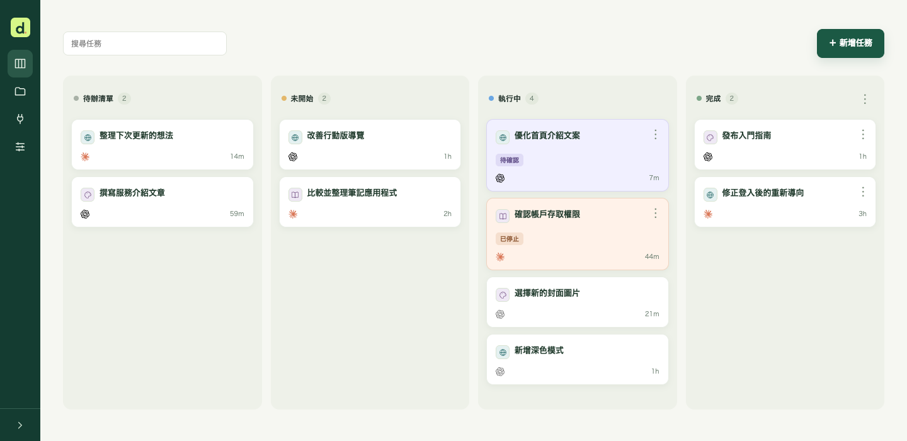
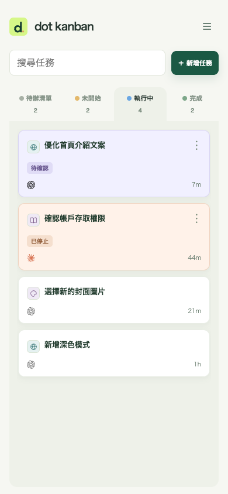
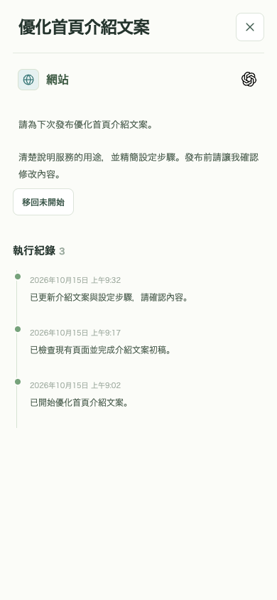

# dot kanban

[English](../README.md) · [日本語](README.ja.md) · [한국어](README.ko.md) · **繁體中文** · [简体中文](README.zh-CN.md)

向 dot 提出工作請求，集中管理任務、進度與成果的個人私人看板。適用於手機與桌面。



## 可以做什麼

- **集中記錄請求：** 將想法儲存至待辦清單，準備交給代理執行時移至未開始。
- **與 AI 一起推進：** 透過 MCP 連接 dot 等相容代理，將對話中的請求、進度與結果記錄在同一任務。
- **找到需要你確認的工作：** 區分待確認、已停止與執行中任務，在詳情的執行紀錄中了解經過。
- **依專案整理：** 以圖示區分專案，依卡片順序決定執行優先順序，並在說明中加入圖片。
- **在手機上使用：** 滑動切換面板、搜尋任務，也可作為 PWA 加入主畫面。

<p>
  
  
</p>

## 準備事項

兩種方法都會將**專屬於你的私人看板部署到你自己的 Cloudflare 帳戶**。尚無帳戶時，請先[註冊 Cloudflare](https://dash.cloudflare.com/sign-up)。使用部署按鈕還需要 GitHub 或 GitLab 帳戶。

**標準組態的一般個人使用預期可在 Cloudflare 免費額度內運作。** 請求數、資料庫容量與儲存量等有上限，大量使用或圖片附件可能需要付費方案。AI 服務訂閱與使用費用另計。目前費用與限制：[Workers](https://developers.cloudflare.com/workers/platform/pricing/) · [D1](https://developers.cloudflare.com/d1/platform/pricing/) · [KV](https://developers.cloudflare.com/kv/platform/pricing/) · [Access](https://www.cloudflare.com/plans/zero-trust-services/)。

<details>
<summary>免費額度估算與注意事項</summary>

- 一個看板持續顯示24小時，每3秒檢查更新約為**28,800次請求／日**，每次僅讀取一列更新編號。任務重新讀取、MCP 等請求另計。隱藏分頁會暫停檢查，多個可見視窗則增加流量。
- [Workers 免費額度](https://developers.cloudflare.com/workers/platform/pricing/)為**每個帳戶10萬次請求／日、每次請求 CPU 10ms**。與其他 Worker 共用額度，處理較重時即使請求少也可能達 CPU 上限。
- [D1 免費方案](https://developers.cloudflare.com/d1/platform/limits/)為**每個資料庫500MB**，包含任務紀錄與圖片附件。另有[每日列讀取／寫入上限](https://developers.cloudflare.com/d1/platform/pricing/)，大量圖片可能需要付費方案。
- OAuth 使用的 [KV](https://developers.cloudflare.com/kv/platform/pricing/)也有限制：**鍵寫入與清單操作各1,000次／日**。頻繁驗證或讀取連線清單可能耗盡額度。

以上依實作與公開上限估算，並非免費方案的實測結果。請查看 Cloudflare 用量頁面；超過免費上限時可能傳回錯誤，而非自動升級。AI 費用另計，選用的實驗性 Events／Container 組態需要付費方案。

</details>

## 設定你的看板

可以請 dot 協助部署與設定，也可以自己點擊按鈕完成。

### 請你的 dot 幫忙

```text
https://github.com/nocico-nocio/dot-kanban
請先閱讀此儲存庫的 docs/INSTALL.zh-TW.md，依照步驟完成我的私人看板安裝、dot 連線與定期檢查設定。需要確認的事項請詢問我。
對話中我新提出的工作也請在開始前用 create_task 登記，並在同一任務記錄進度與結果。不要重複登記既有任務。
```

完整步驟請參閱 [INSTALL.zh-TW.md](INSTALL.zh-TW.md)。dot 會在安裝時確認執行位置與檢查間隔。

### 自行部署至 Cloudflare

透過下方按鈕部署到準備好的帳戶，無須事先手動 Fork。[Cloudflare 會在你的 GitHub／GitLab 帳戶中建立儲存庫副本](https://developers.cloudflare.com/workers/platform/deploy-buttons/)，並連接 Workers Builds。

[](https://deploy.workers.cloudflare.com/?url=https://github.com/nocico-nocio/dot-kanban)

部署後依 [INSTALL.zh-TW.md](INSTALL.zh-TW.md) 設定僅限本人登入與代理的 MCP 連線。按鈕部署看板後，仍須設定驗證與定期檢查。

## 更新看板

也可以請 dot 將既有看板更新至最新版。透過按鈕安裝後，將原始儲存庫的變更整合至自己的副本，push 至連結的正式環境分支即可[重新部署](https://developers.cloudflare.com/workers/ci-cd/builds/git-integration/github-integration/)。原始儲存庫的變更不會自動同步。請備份資料庫，並保留既有 Worker、資料庫與驗證設定。參閱[更新步驟](INSTALL.zh-TW.md#updates)。

## 版本紀錄

### 1.0 — 2026-10-15

首次發布。個人私人看板、MCP 任務登記與進度紀錄、專案管理、圖片附件及行動版／PWA 支援。

## 使用其他代理

以下用戶端提供 MCP 整合；驗證與定期執行能力依產品和帳戶而異，本看板的 Grok 連線尚未驗證。請複製對應的指令，先在使用環境中驗證連線、任務讀寫與定期執行，再開始使用。

| 代理                                                                                                                                              | 執行與定期檢查                                              |
| ------------------------------------------------------------------------------------------------------------------------------------------------- | ----------------------------------------------------------- |
|  [Claude / Claude Code](https://code.claude.com/docs/en/scheduled-tasks) | 本機使用 `/loop` 或本機排程，雲端使用 `/schedule` routine。 |
|  [Grok / Grok Build](https://docs.x.ai/grok/connectors)                    | 自訂 MCP / Grok Build；請在使用的功能中確認排程支援。       |
|  [Codex](https://developers.openai.com/codex/mcp)                         | CLI／應用程式的 MCP 連線；在選定環境中另行設定定期執行。    |
|  [Gemini CLI](https://geminicli.com/docs/tools/mcp-server/)              | 本機 MCP 連線；使用系統排程器等另行設定定期執行。           |
|  [Cursor](https://cursor.com/docs/mcp)                                   | 桌面／Cloud Agent 的 MCP 連線；各環境分別設定定期執行。     |

**若雲端與本機採用不同執行功能，須分別設定 MCP 連線與定期檢查。** 單純連線不會啟動巡查。多個連線時，可在 MCP 連線頁面選擇預設，並為任務選擇負責代理。

<details>
<summary>Claude / Claude Code — 設定指令</summary>

```text
https://github.com/nocico-nocio/dot-kanban
請先閱讀此儲存庫的 docs/INSTALL.zh-TW.md，為 Claude / Claude Code 完成看板安裝、MCP 連線與定期檢查設定。請向我確認執行位置與檢查間隔，並明確指出此環境不支援的功能。
對話中我新提出的工作也請在開始前用 create_task 登記，並在同一任務記錄進度與結果。不要重複登記既有任務。
```

</details>

<details>
<summary>Grok / Grok Build — 設定指令</summary>

```text
https://github.com/nocico-nocio/dot-kanban
請先閱讀此儲存庫的 docs/INSTALL.zh-TW.md，為 Grok / Grok Build 完成看板安裝、MCP 連線與定期檢查設定。請向我確認執行位置與檢查間隔，並明確指出此環境不支援的功能。
對話中我新提出的工作也請在開始前用 create_task 登記，並在同一任務記錄進度與結果。不要重複登記既有任務。
```

</details>

<details>
<summary>Codex — 設定指令</summary>

```text
https://github.com/nocico-nocio/dot-kanban
請先閱讀此儲存庫的 docs/INSTALL.zh-TW.md，為 Codex 完成看板安裝、MCP 連線與定期檢查設定。請向我確認執行位置與檢查間隔，並明確指出此環境不支援的功能。
對話中我新提出的工作也請在開始前用 create_task 登記，並在同一任務記錄進度與結果。不要重複登記既有任務。
```

</details>

<details>
<summary>Gemini CLI — 設定指令</summary>

```text
https://github.com/nocico-nocio/dot-kanban
請先閱讀此儲存庫的 docs/INSTALL.zh-TW.md，為 Gemini CLI 完成看板安裝、MCP 連線與定期檢查設定。請向我確認執行位置與檢查間隔，並明確指出此環境不支援的功能。
對話中我新提出的工作也請在開始前用 create_task 登記，並在同一任務記錄進度與結果。不要重複登記既有任務。
```

</details>

<details>
<summary>Cursor — 設定指令</summary>

```text
https://github.com/nocico-nocio/dot-kanban
請先閱讀此儲存庫的 docs/INSTALL.zh-TW.md，為 Cursor 完成看板安裝、MCP 連線與定期檢查設定。請向我確認執行位置與檢查間隔，並明確指出此環境不支援的功能。
對話中我新提出的工作也請在開始前用 create_task 登記，並在同一任務記錄進度與結果。不要重複登記既有任務。
```

</details>

MIT 授權：[LICENSE](../LICENSE)。
